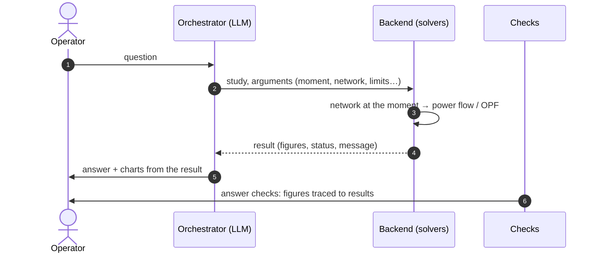

# How it works

These pages describe what is behind an answer: the models, the mathematics
and the algorithms of every study CONDUCTOR runs, the conventions they share,
and what they assume. They are written for engineers and researchers who want
to know exactly what a figure means, check it against the code, or build on it.
For how to *use* the studies, see the [Guide](../guide/getting-started.md).

## The division of labour

CONDUCTOR separates three roles, and the separation is the design:

- **The solvers compute.** Every number in an answer — a voltage, a loading, a
  cost, a dispatch — comes from a power flow or an optimisation run by the
  backend on the network at a given moment. The backend is ordinary Python:
  [pandapower](https://www.pandapower.org/) for power flows, Pyomo with IPOPT for
  optimisation, FastAPI for the interface.
- **The orchestrator chooses and explains.** A language model reads the
  question, chooses which studies to run and with which arguments, and writes
  the answer from their results. It does not compute figures, and checks after
  the answer compare what it wrote with what the studies returned.
- **The advisor discusses.** A second language model helps the operator think
  results and options through and suggests next studies. It runs nothing: a
  study it suggests goes to the orchestrator's box, for the operator to send.

See [The agent and its checks](the-agent.md) for the orchestrator, the
advisor and the safeguards between them and the solvers.

## Principles every study follows

1. **One network at one moment.** A study runs on the loaded network (or a
   proposal: a copy with changes, never the loaded network itself) with the
   injections of one moment of the data — measured, forecast, or the network's
   nominal point. See [Network, data and the operating point](network-and-data.md).
2. **Physics first.** The state of the grid is an AC power flow. Optimisation
   proposes dispatches; every corrective option is solved again by an ordinary
   AC power flow before it is shown, and the answer says whether that check
   confirms it.
3. **Options, not an answer.** A corrective action comes as several dispatches,
   each the optimum of a stated strategy, scored the same way; the operator
   chooses. See [Corrective options](corrective-options.md).
4. **Unknown is not zero.** A study that finds no solution, or a moment that
   cannot be studied, is reported with its reason — never as 0 MW, 0 % or 0 €.
5. **Named, stable references.** Options carry references (`S3:cheapest`) so a
   later study can apply one, at its own moment or held at a later one.

## Conventions

| Quantity | Unit and sign |
| --- | --- |
| Active and reactive power | MW and Mvar. A unit's output is positive when it generates. |
| External grid exchange | MW, **positive = import** into the network studied. |
| Voltage magnitude | per unit (p.u.) of the bus's nominal voltage. |
| Branch loading | percent of the branch's rating: a line's current against its rated current, a transformer's current at rated voltage against its rated power (see [Power flow and security](power-flow-and-security.md#what-counts-as-a-violation)). |
| Cost of an action | €/h, relative to the schedule; negative is a saving. |
| Time | 15-minute resolution in the bundled data; a window's total weights each moment by the time it stands for. |

**Two sets of limits.** A *security assessment* judges a power flow against the
network's limits: by default the network's own voltage band and 100 % loading,
or the limits the operator gives. An *optimisation* keeps the same voltage band
(again the network's own unless given) but holds every branch to a **current
margin** — 90 % of its rating by default — so a corrective dispatch has room to
spare when the power flow checks it. Answers name the limits they used.

## Notation

Used across these pages; each page adds its own.

| Symbol | Meaning |
| --- | --- |
| $\mathcal B$, $\mathcal L$, $\mathcal G$, $\mathcal E$, $\mathcal D$ | buses, branches (lines and transformers), controllable units, external-grid connections, loads |
| $\mathcal G^{f} \subseteq \mathcal G$ | units the optimisation may move (all but those the operator holds and those whose bounds fix their output: synchronous condensers, units marked not dispatchable) |
| $V_b,\ \theta_b$ | voltage magnitude and angle at bus $b$ |
| $P_g,\ Q_g$ | active and reactive output of unit $g$ |
| $P_g^0,\ Q_g^0$ | the same, as scheduled (the moment's data) |
| $P_e^{\text{ext}},\ Q_e^{\text{ext}}$ | exchange with the external grid at $e$ (import positive) |
| $P_d,\ Q_d$ | demand of load $d$ |
| $\underline V,\ \overline V$ | voltage limits; $\overline\ell$ a loading limit in percent |
| $\mathcal F$ | the dispatches the optimal power flow accepts: every constraint of [the OPF](optimal-power-flow.md) satisfied |

## The pages

| Page | What it covers |
| --- | --- |
| [Network, data and the operating point](network-and-data.md) | How a network and a moment of data become a solvable operating point; the bundled networks; the synthetic series; proposals |
| [Power flow and security assessment](power-flow-and-security.md) | The AC power flow, the limits, what a violation is |
| [Contingency analysis (N-1)](contingency-analysis.md) | The N-1 screen, islanding, outages that do not converge, N-1-1, attribution |
| [Investigating a cause](investigation.md) | Why an element is outside its limits: its change since a state where it was fine, divided among the causes (Shapley values over AC power flows), with verdicts and levers |
| [The optimal power flow](optimal-power-flow.md) | The AC OPF behind every corrective action: variables, constraints, objective, solver |
| [Corrective options](corrective-options.md) | The strategies, the cost of an action, how options are chosen and checked, when redispatch is not enough |
| [Near-optimal alternatives](near-optimal-alternatives.md) | Modelling to generate alternatives: the budget, the methods, choosing diverse options |
| [N-1 security](n1-security.md) | Preventive and corrective security-constrained OPF, the outages studied, what remains unsecured |
| [Studies over time](over-time.md) | Holding an option, one plan for a window, the cost of security over a window |
| [Key performance indicators](key-performance-indicators.md) | The schedule against a corrective action: security, flexibility required, activated and deliverable, cost |
| [Risk, uncertainty and capacity](risk-and-capacity.md) | Probabilistic assessment, robust dispatch, flexibility envelopes, hosting capacity, historical risk |
| [The agent and its checks](the-agent.md) | The orchestrator, the advisor, the tools, and the checks that keep answers tied to results |
| [Assumptions and limits](assumptions-and-limits.md) | What the models leave out, where results can mislead, and how they have been tested |
