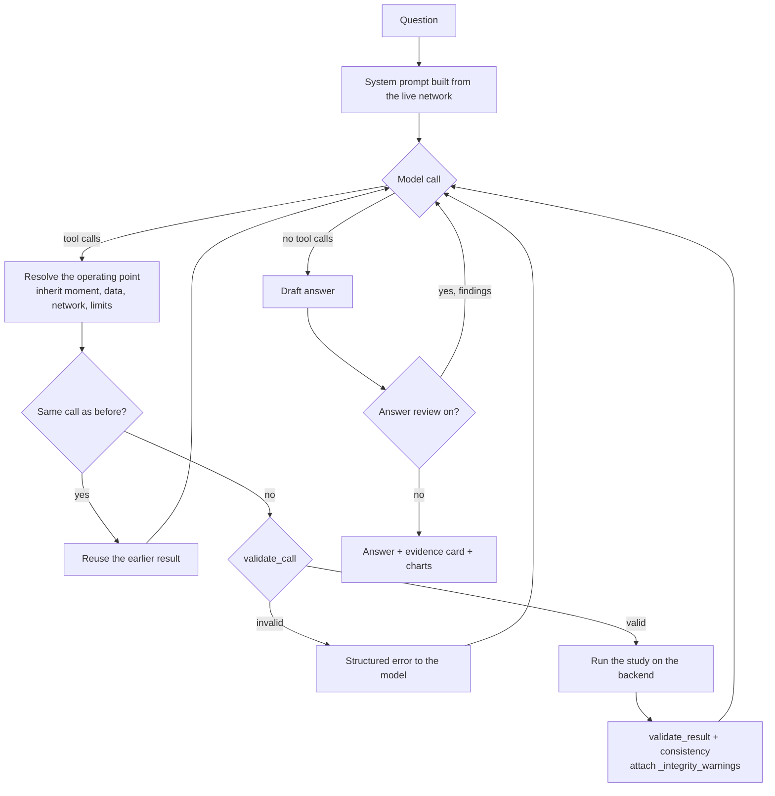

# The agent and its checks

The language models in CONDUCTOR choose studies and write about their results;
they do not compute. This page describes how a question becomes tool calls, what
stands between the model and the solvers, and the checks that compare a written
answer with the results it was written from.

## One question, step by step

1. **The system prompt is rebuilt for every question** from the network loaded
   in the backend: its name and size, its limits, its units and substations
   (named as the data and every result name them: a bus's own name, or
   `Bus_<index>`), the data sources, the costs. Arguments keyed by unit
   (`hold_units`, `fixed_setpoints`, capacity overrides) take unit names. If
   the backend cannot be reached, the prompt says the grid's identity is
   unverified and tells the model not to state it.
2. **The model calls tools.** Thirty-four tools are declared, each a thin wrapper
   around one backend endpoint (see the [tool reference](../reference/tools.md)).
   Shared arguments — the moment, the data source, the network or proposal, the
   load power factor — are injected into each tool's schema from one registry,
   so every tool spells them the same way.
3. **Each call is resolved, validated, run and checked** (below).
   The prompt keeps what decides a call: which tool, which arguments. How to
   report a study comes with that study's result (`how_to_report`, from
   `reporting_notes.py`), only in the copy the model reads. So a question pays
   for that guidance only when the study ran, and the logged result, which the
   answer checks read, stays as the tool returned it.
4. **The model reads the results and either calls more tools or answers.** At
   most 16 model calls per question; when the limit is reached, or the model
   keeps repeating a failed call, one last call asks it to answer from what it
   has, and the answer says so.
5. **The answer is checked** against the results, and the checks are shown
   under it in *What backs this answer*.

Every turn is written to a session log (one JSON line: the question, every call
with its resolved arguments, every full result, the answer, timings), which the
answer's card, the reports and the offline graders all read.

**What the model sees.** The full results go to the log, the charts and the
checks. The model gets the same results with long time series reduced to their
extremes (a scan over time, for example, becomes the window, the number of
violating steps, the first twelve violating moments and the worst one). The
figures the loop computes for that reduced view — the scan's summary, counts,
the full length of a list it shortened — are logged with the result
(`summary_for_model`), so the answer checks can trace them. A scan that failed
reaches the model as it is, error included, never as an empty summary. Results
of *earlier* questions longer than 1,500 characters are cut in the history sent
to free-tier models; the current question's results are never cut.

## Between the model and the solvers

| Safeguard | When | What happens |
| --- | --- | --- |
| **The operating point carries forward** | before each call | Within one question, the first explicit moment, data source, network, load power factor and limits are kept: a later call that leaves one out gets it, where the tool takes it (and the answer's card shows it as *carried forward* under *How it ran*). Not when the question compares two values of that field — a proposal with the base (the network), the forecast with the measurements (the data source), two power factors (the load power factor): there an omitted value means the default, as each tool's schema says. A call that fails withdraws what it established, so a refused value is not inherited. Voltage limits stated in words in the question ("below 0.96 p.u.") seed the question's limits before any call. |
| **Duplicate calls** | before each call | The same tool with the same resolved arguments is not run twice: the model is pointed to the earlier result, or told the earlier failure would repeat. A third identical failure ends the loop. |
| **Parameter validation** | before each call | Impossible values are refused with the reason, and the call is not run: a probability outside (0, 1), a voltage limit outside 0.5–1.5 p.u., an inverted band, a load scaling outside the network's range, a load power factor outside 0.5–1, a negative capacity override. Unusual but legal values (a data source other than `measurements`, `forecasts` or `nominal`, for example) run, and the warning is attached to the result (`_integrity_warnings`, code `parameter_warning`); while the question runs, the app's status box says the study "ran with unusual parameters". |
| **Unsupported combinations** | inside the tool | An argument a study does not support returns `refusal_required` with an instruction: tell the operator it is unsupported and what is available instead, never approximate it with another study. |
| **Limits sent only when chosen** | the request | A limit the model leaves out is not sent, so the backend uses the network's own rather than a default indistinguishable from a choice. |
| **Result self-consistency** | after each call | A result is annotated (`_integrity_warnings`) when a voltage is physically implausible, an "optimal" dispatch has a bus outside its own bounds, or a violation count disagrees with its list. Data are never dropped; the model is told to state the warning before the figures it affects. |
| **Consistency across calls** | after each call | Results computed at different moments, datasets, networks or limits in one answer are flagged, unless the question itself compares them (two named moments; forecast against measured; a proposal against the base). |
| **Proposal note** | after the answer | When a result came from a proposal the answer does not name, a note says so. |

## Checking the answer

Three checks read the written answer against the results of the same question.
They describe; they do not certify — a figure that passes can still be wrong,
and a flagged one can be right. Their findings are shown, never used to change
the answer silently.

### Provenance: where does each number come from?

1. **Clean the text**: unify the minus sign; drop code, table rules, list
   markers, dates and clock times (ISO timestamps, "18:15", "6 January"), and
   the notes CONDUCTOR itself appends (the step limit it stopped at, or the
   call it stopped on), whose figures are settings, not claims.
2. **Extract the numbers** not glued to a word (so `L30` and `10kV` in names are
   skipped), with their decimals, the unit that follows (%, p.u., MW, MVAr, MWh…)
   and 55 characters of context either side.
3. **Collect the sources**: every number in every result of the question
   (recursively, including digits inside strings such as names, but not the
   digits of dates and clock times), the grid facts the prompt stated, the
   arguments each study ran with, and the question itself (dates and times
   left out there too). Each source remembers which element it belongs to.
4. **Match** each number to the sources at the precision it is written: within
   half a unit of its last decimal (`0.931` matches 0.9305–0.9315; whole numbers
   ±0.5). A percentage also matches the same value as a fraction. Near a
   direction word (import, export, inject, absorb…) the opposite sign matches too.
5. **Verdict:**

| Verdict | Meaning |
| --- | --- |
| **grounded** | a source rounds to it |
| **imprecise** | truncated rather than rounded: within one unit of the last decimal |
| **derived** | the answer shows the division that produces it (`a / b`), with both operands from the results |
| **misattributed** | the number exists, but only under *another* violated element than the one the sentence is about (the most recently named element before it) |
| **ungrounded** | no source |

The traceable rate is (grounded + imprecise) / numbers. Derived figures are
counted apart, as not traceable, on purpose: a calculation in prose is the kind
of figure the design keeps out of answers.

### Characterisation: is a true figure described truly?

A number can be traced and still be described the opposite way. The check takes
numbers whose own record carries an unfavourable flag — a move marked not
feasible, a source not actionable, an element violated, a study not converged or
not secure — and flags the sentence that uses that number with a favourable word
("reduce", "dispatch", "should") and no negation before it. A number in the
answer matches a flagged one within half a unit of its last stated decimal, as
in provenance. A second, study-level check flags an answer that calls an
insecure result secure ("within limits", "no violations", "all clear") anywhere,
or a study that did not converge, gave no usable result or found no feasible
dispatch successful ("solved", "succeeded"), except where the question compared
a base with a proposal, or found a corrective dispatch and states the
violations. The words "result" and "answer" are not read as favourable: a
correct decline uses them too.

### Completeness: did it answer what was asked?

Five kinds of question — a percentage, an amount of power, a voltage, a moment,
a count — each recognised by a pattern. An answer to such a question that
contains no figure of that kind, and does not decline, is flagged as possibly
incomplete (it may be right: the answer may be that it cannot be known).

### Evidence: what backs each claim?

An answer mixes statements of very different standing, which prose makes sound
equally sure. Each claim is given its **evidence level**, from the turn record
alone (`evidence.py`):

| Level | What backs it | Example |
| --- | --- | --- |
| **Proved** | a certificate inside a result: a convex relaxation's lower bound, or its proof that no dispatch exists | *no dispatch costs less than 22.48 €/h* |
| **Power flow** | an AC power flow of the network: physics, for the data given | *L0 at 114.7 %* |
| **Optimised** | the optimiser's solution: a local optimum | *the cheapest option costs 26.48 €/h* |
| **Estimated** | a statistic over sampled scenarios | *a 3.5 % chance of a violation* |
| **Input** | the question, the network's data, the measurements, or a setting the study used — *assumed* when the question did not give it | *loads at power factor 0.95* |
| **Derived** | arithmetic in the answer on figures it quotes | |
| **Interpretation** / **Advice** | the agent's own reading ("probably", "due to") or a recommendation | |
| **Unsupported** | in no result of this turn | |

A figure takes the level of the field it comes from: the tool's kind
(`tool_registry.evidence`), refined by where the value sits — a bound inside an
options result is a proof, an option's power-flow check a power flow, an
echoed setting an input. Provenance keeps the first value that matches, which
can be a result's message repeating the bound, or a label (bus 4 for a gap of
4.00 €/h); the evidence grading therefore looks at every value of the turn that
matches, keeps fields of their own whose unit agrees with the one written (€,
MW, %, p.u.), and takes the strongest.

A sentence without figures is graded by what it asserts: a proof ("proved",
"impossible", "the best possible", "no dispatch exists"), safety ("secure", "no
violations"), the agent's interpretation, or advice. A proof with no
certificate in the turn's results, or safety with no study behind it, is
**overstated** — the one finding this check raises: the solver found no
dispatch, and the prose says none exists. A negation earlier in the same clause
("not an N-1 screen or a guarantee of security") hedges a claim. On the 145
answers in the project's session logs it raises no false alarm.

### Where the findings go

- **What backs this answer**, one card under each answer. Always in view: the
  claims counted per evidence level, the number of concerns, the reading
  check's verdict, and (in the Details label) the studies run, the figures
  traced and the time. In Details, the concerns first — untraced and
  misattributed figures, characterisation conflicts, overstated claims,
  possible gaps, integrity warnings (parameter warnings included), tool errors —
  then four tabs: **Claims** (each claim with what backs it, figures grouped by
  study), **Readings** (each other reading of the question and what it gave),
  **How it ran** (each study with its arguments, what was carried forward and
  the time) and **Limits** (what the checks cannot see). The figures in the text
  can be coloured by level.
- **Answer review** (off by default; the operator can switch it on) runs the
  same checks on the draft — both characterisation checks included — and, once,
  gives the model the findings — untraced and misattributed figures, conflicts,
  gaps — with neutral wording: it may keep the answer, correct it, or run a
  study, and if it keeps a figure it should say where it came from. The card
  says when an answer was revised. The findings and the draft they were about
  stay in the turn's record but are taken out of the conversation history, so
  later calls see only the answer the operator received.
- **The advisor's concerns** about an answer come from the same checks.
- **Staleness.** Each answer is stamped with the settings its studies ran under
  (load power factor, generator models, data). When those change later, the
  answer is marked as computed under other settings, with an offer to re-run.

## The reading check: does the answer depend on how the question was read?

A question leaves things open: "is the grid secure now?" does not say at which
load power factor, against which loading limit, on measured or forecast data.
The agent reads it one way — the defaults — and the answer is only as good as
that reading. The clarification rule asks first only when no default fits;
answering silently from one reading hides that the conclusion may hang on it.

After the answer, CONDUCTOR therefore re-runs the turn's decisive studies under
the readings the question left open, and compares their conclusions with the
answer's (`robustness.py`):

- **Which readings are open.** One the question does not mention and the study
  ran with at its default: the load power factor (when no session setting is
  in force), the loading limit (the network's own for an assessment, the
  optimiser's 90 % margin for a dispatch), the voltage band (the network's own,
  when it differs from ±5 %), the data (measured, for a moment that also has a
  forecast). The agent passes defaults explicitly, so an argument settles
  nothing by being there; a value other than the default came from the
  operator, and is left alone.
- **The alternatives.** Power factor 0.90 and 1.00; 90 % against 100 % of the
  rating (or the full rating for a dispatch); the common ±5 % band; the
  forecast.
- **The studies.** Those with one clear verdict and no side effects — the
  security assessment, single and full N-1 screens, the two optimisations (run
  so the backend keeps nothing: no option set, no "last dispatch"). At most two,
  the answer's main one (the last) first with every reading, eight re-runs and
  25 s at most.
- **The comparison**, from the studies' own fields, never the prose: the
  conclusion **holds** (the same verdict, its figure within 10 %), **shifts**
  (the same verdict, a figure that moves more) or **changes** (another verdict:
  secure, a dispatch exists, options or not).

When a reading changes the conclusion, the answer's card names the reading and
what it gives, in CONDUCTOR's words; the same note is kept with the answer the
model reads in the next question and in the session reports. On the 30-bus demo, *Is the grid secure at 04:00 on 6 January?*
is answered secure; at power factor 1.00 instead of the default 0.95 the
assessment finds a violation at Bus_23. At 20:00 with loads at 125 %, the
answer that redispatching cannot clear the violations is *proved* — for the
power factor assumed: at 1.00 a dispatch moving 91 MW exists. A proof is only as
general as the reading it was computed under, and the check makes that visible.

## The advisor

The advisor is a second call to the same model, **without tools**. It reads a
digest of the session — the last ten messages, a line per earlier question, the
latest results compacted, the concerns the checks raised, the corrective options
on the table with their solver figures — and does three things on request:

- **Suggest** three or four next studies from different angles (deeper, a
  stress test, a change to the grid, a step back), each a self-contained request
  the operator can edit and send to the orchestrator;
- **Discuss**: separate evidence from opinion, ask what matters to the operator
  before recommending, and turn the operator's criteria into studies that can be
  run (hold a unit, near-optimal alternatives, a branch limit, N-1, a plan over
  time). With options on the table it **never picks one**;
- **Write a decision note**: the decision, the criteria, the evidence, the open
  risks. The chosen option's figures are copied from the solver result, not from
  the model's text.

It cannot run a study or move the clock, and its own figures are checked against
every result of the conversation; untraced ones are listed as unverified.

## Models

The orchestrator and the advisor run on the model the operator chooses: Google
Gemini, OpenAI, Anthropic, OpenRouter, NVIDIA, DeepSeek, any OpenAI-compatible
service, or a local model through Ollama (see
[Model options](../reference/providers.md)). The tool schemas are written once
and converted to each provider's format. Temperature is 0 where the provider
accepts it. Transient errors are retried with exponential back-off (at most 10
attempts, never sooner than the server asks). A local model refuses a request it
estimates will not fit its context window rather than letting the system prompt
be truncated silently.

## Evaluation

The [research guide](../research/using-conductor-in-research.md) describes how to
use these in studies. In short:

- **Graders** read session logs with fixed rules — no model as judge, nothing
  hand-labelled — so a grade is exactly reproducible on old logs. They replay
  the live checks (consistency, provenance, characterisation, completeness) and
  add their own: a requested moment not used, an unsupported request not
  declined, a proposal not named, a proposal with violations the base does not
  have (a warning), the clock moved by a study, an **overstated claim** (a
  failure: a proof or safety asserted with nothing behind it), and an
  **untested cause stated as a finding** (a failure: the answer presents as
  established a hypothesis its own investigation recorded as untested). With `--json`
  each turn also reports its claims per evidence level and what the reading
  check found. A question CONDUCTOR stopped at
  the step limit, or after a repeated failure, is a warning when it still
  answered from the results so far, and a failure when it did not.
- **Task suites** run the real agent on fixed tasks and check what it did: ten
  network-proposal tasks on IEEE 14, eleven corrective-option tasks on IEEE 30
  (including that the choice is left to the operator), five clarification
  tasks (asking first only when it changes the answer), nineteen
  investigation tasks (a why about a problem in the grid is investigated and
  recorded; a why about a method, a recommendation or physics is not; a missing
  symptom is said; the agent's own hypotheses are tested; an untestable one is
  said, with the tool it would need; an injected cause is reported; what the
  forecast says is coming is looked ahead, with when to decide), and six
  narration tasks (a study whose reporting guidance comes with its result is
  reported as that guidance says). They run with answer review off.
- **The investigation bench** needs no model: it injects known causes into the
  demo and checks that the [investigation](investigation.md) finds them.

## What the checks cannot see

- A right number under a wrong label is grounded: provenance checks where a
  number came from, not whether it answers the question.
- Small integers are easily grounded by coincidence, because digits inside
  names count as sources: a made-up "9 violations" can be traced to the 9 in
  `Bus_9`. (Dates and clock times are not sources.)
- The direction of a flow is not checked: near "import" or "export", either sign
  matches.
- Numbers in code formatting, dates and clock times are not checked.
- A figure quoted from an earlier question, or from an earlier session, is
  untraced by construction: only the current question's results count.
- Only written divisions, and counts written as a share of a written total
  ("95 % — 190 of 200 samples"), are recognised as derivations; a sum or a
  difference is untraced.
- Characterisation sees only flagged fields, and its matching is by words: it can
  miss a paraphrase and fire on a correct sentence.
- A model that passes a limit explicitly overrides the limit stated in the
  question; only omitted limits are inherited.
- Evidence levels say what kind of evidence stands behind a claim, not that the
  claim is true: a power flow's figure is only as right as the data and the
  network model. Assertions are recognised by words; a proof or a safety claim
  in other words is not graded.
- The reading check varies only the readings it knows (power factor, loading
  limit, voltage band, data) for five studies; a question open in another way
  (which moment "the peak" is, say) is not checked. It compares verdicts, so a
  conclusion the answer draws from a figure in its own words is not re-checked.

## In the code

| What | Where |
| --- | --- |
| The loop, duplicate calls, the step limit, what the model sees, the session log | `llm_agent/agent/loop.py` |
| Tool declarations, the registry of shared arguments, the wrappers | `tool_schemas.py`, `tool_registry.py`, `tools.py` |
| Operating point, parameter validation, result consistency | `validators.py` |
| Provenance, characterisation, completeness | `provenance.py`, `characterisation.py`, `completeness.py` |
| Answer review, the card's audit data, staleness | `reflection.py`, `trace.py`, `staleness.py` |
| Evidence levels, the reading check | `evidence.py`, `robustness.py` (re-runs through `tools.unrecorded`) |
| The advisor, session context, reports | `recommender.py`, `session_context.py`, `report.py`, `tailored_report.py` |
| The system prompt | `system_prompt.py`; how to report a study, sent with its result: `reporting_notes.py` |
| Graders and task suites | `evaluation/` |
